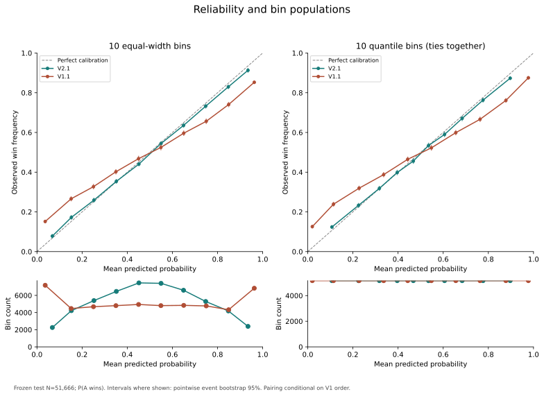
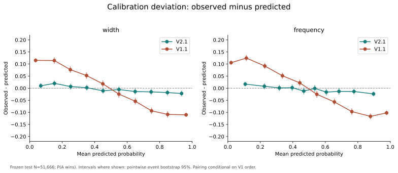
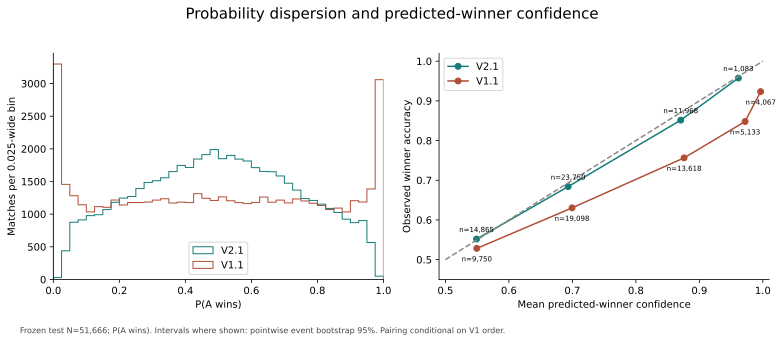
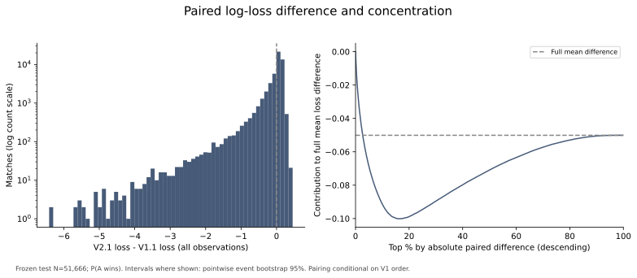

# Final reproducibility, calibration and log-loss audit

24 November 2026. Frozen test population: **51,666 matches**.
Comparison: V2.1 equal-weight direct classifier (A), versus V1.1
inverse-validation-MAE serve ensemble followed by analytical scoring (B).

**The saved V2.1 probabilities have substantially smaller grouped calibration
errors and fewer extreme adverse losses. These explain the shape of its better
average probabilistic scores, without establishing a material accuracy/AUC
advantage or a causal fault in the Markov transformation. Full-population paired
findings remain conditional on preserved V1.1 order.**

## Reproducibility and scope

This new package imports the unchanged Point 3 alignment, metrics and cluster
helpers. It does not rerun its entry point, old tests, notebooks, scoring engine,
ML inference or training. The three original artifacts and the saved scoring
sidecar match their Point 3 SHA-256 values before and after analysis. Original
metrics reproduce within **3.33e-15**. The run uses 5,000 whole-event and 5,000
calendar-block replicates for primary calibration, and event replicates for
the three prespecified exploratory subsets. There are 1,407 event editions and
25 calendar blocks; the small number of blocks limits that sensitivity design.

The publication commit pins the added code; its preceding immutable source
baseline is `981fa3d7b23187f8b7073b1d6eadf9490023f8c8`.
Actual-byte input/code/output hashes, environment and seeds are recorded in
`results/manifest.json` and `results/summary.json`. The public-package manifest
also covers reports, receipts and plots. See [README.md](README.md) for commands,
`1e-12` metric and `1e-10` scientific-result comparison tolerances, and private
input placement. The compact allowlist excludes all private row-level files.
**43 deterministic tests passed**, including analytic calibration coefficients,
log-loss/tail arithmetic, boundary handling, explicit repeated-row bootstrap
cross-checks, hash rejection before deserialization, population/orientation
checks and output protection.

Execution qualification: the available runtime's Parquet-reader binary was
incompatible with its Python version. This run therefore reused the preserved
Point 3 private aligned CSV. Original V1 joblib and metadata were loaded and
the export checked against their probabilities, common metadata, orientation,
counts, expected metrics and scoring sidecar. Original V2 Parquet bytes were
hashed, **not decoded again in this run**. The CSV hash is first recorded in
Point 4, and its V2 lineage is inherited from Point 3. The provided default
original-Parquet route remains an optional independent reviewer check and was
not exercised here. This restriction is additional to the historical V1
missing-identity limitation; neither is concealed by metric agreement.

The package addresses downstream evaluation. It does not reproduce all upstream
feature decisions or establish complete historical source availability. A reviewer
requires authorized private input access, not Google Drive, Colab, a GPU, raw
history download or retraining. [Rights and provenance](rights_and_provenance.md)
records the unavailable original upstream URL and unresolved file-specific rights.
No new blanket software licence or data-sharing permission is inferred.

## Calibration findings

Both probabilities mean `P(Player A wins)`; the observed A-win frequency is
**0.49603221**. Calibration below is descriptive on the frozen final test set.

| Diagnostic | V2.1 | V1.1 |
|---|---:|---:|
| Brier score | 0.19887455 | 0.20670643 |
| Mean probability | 0.50111383 | 0.49619913 |
| Probability standard deviation | 0.23734623 | 0.30962518 |
| Joint diagnostic intercept | -0.02545706 | -0.00505993 |
| Joint diagnostic slope | 0.92678820 | 0.50671590 |
| Calibration-in-the-large intercept, slope fixed to 1 | -0.02623984 | -0.00108308 |
| ECE, 10 equal-width bins | 0.01116688 | 0.07911764 |
| MCE, 10 equal-width bins | 0.02187796 | 0.11520963 |
| ECE, 10 quantile bins | 0.01072681 | 0.07934168 |
| MCE, 10 quantile bins | 0.02359500 | 0.12474955 |
| Mean predicted-winner confidence | 0.69851584 | 0.76815879 |
| Winner accuracy | 0.69047343 | 0.68904115 |

The joint diagnostic estimates `logit E[Y]=a+b*logit(p)`; an ideally calibrated
relationship has `a=0,b=1`. V1's slope near 0.507 and reliability curve indicate
excessive probability spread relative to observed frequencies. Its near-correct
overall mean does not establish calibration: positive and negative errors can
cancel. V2 is much closer under these diagnostics but is not perfectly calibrated;
its mean probability exceeds the outcome frequency by 0.00508 and slope is below 1.
Event-resampled mean-bias intervals are [0.00107,0.00914] for V2 and
[-0.00393,0.00430] for V1. The smaller global mean bias of V1 coexists with worse
conditional calibration.

Diagnostic intercept/slope coefficients solve test-set likelihood equations;
they are point estimates without claimed coefficient confidence intervals. They
are **never applied to predictions**. This is not a fitted production calibrator
or an unbiased recalibration performance experiment. No authenticated validation
match-probability pair for both final models was supplied; notebook source
describes final train+validation refits. The referenced V1 validation export is
serve-regression output, not an authenticated paired match-calibration dataset.
See `validation_prediction_inventory.json`; no cells were executed.

Bins include their counts and mean probabilities, observed frequencies, and
observed-minus-predicted differences in `results/reliability_bins.csv`. The
summary adds event/block intervals on observed frequencies and deviations.
Empty bins are retained with undefined means; fewer than 100 observations is
flagged. Quantile cut ties stay together and duplicate cuts collapse explicitly.
Grouping can conceal miscalibration within a bin.

ECE is the count-weighted absolute deviation across bins; MCE is the maximum
occupied-bin deviation. Both depend on binning, population and sampling noise.
Across width/quantile choices with 5/10/20 bins, V2 ECE ranges **0.01073–0.01234**
and V1 **0.07493–0.07934**. For 10 equal-width bins, the paired ECE difference
(V2 minus V1) is **-0.06795**; event 95% interval **[-0.07087,-0.06348]**,
calendar sensitivity **[-0.07153,-0.06243]**. All six grouping choices favour
V2 under both designs. These are pointwise descriptive percentile intervals,
with quantile cutpoints fixed to the original sample, not universal calibration
guarantees or simultaneous confidence coverage.

Winner confidence is `max(p,1-p)` and correctness is `1[(p>=.5)==y]`, once per
match. V1's 5,133 predictions in `[.95,.99)` have mean confidence **0.97204**
but observed accuracy **0.84804**. Its 4,067 predictions in `[.99,1]` average
**0.99654** confidence but **0.92328** accuracy. V2 has 1,083 predictions in
`[.95,.99)`, averaging **0.96148** confidence and **0.95753** accuracy, and none
in `[.99,1]`. These different confidence populations are descriptive, not
matched causal treatment groups. All confidence strata, including empty ones,
are reported in the JSON summary.

## Why mean log loss differs

Log loss uses natural logarithms and float64 epsilon clipping only for numerical
evaluation; original probabilities are preserved. Results:

| Individual loss summary | V2.1 | V1.1 |
|---|---:|---:|
| Mean | 0.58104872 | 0.63115991 |
| Median | 0.47828647 | 0.38426474 |
| Standard deviation | 0.45195189 | 0.80014460 |
| 95th percentile | 1.45587117 | 2.08207244 |
| 99th percentile | 2.17441290 | 3.95129107 |
| 99.9th percentile | 2.96554306 | 6.85157452 |
| Maximum | 3.78368325 | 9.86670984 |

The paired difference `L(V2)-L(V1)` has mean **-0.05011119** but median
**+0.06824980**. Thus V2 has higher individual loss on a majority of matches,
while sufficiently large improvements on adverse cases dominate the arithmetic
mean. Lower individual median V1 loss and lower mean V2 loss are compatible.
The logarithm penalizes assigning very small probability to the actual outcome.

| Probability assigned to observed outcome | V2 count | V1 count |
|---|---:|---:|
| Below 0.01 | 0 | 312 |
| Below 0.05 | 46 | 1,092 |
| Below 0.10 | 384 | 2,097 |
| Below 0.20 | 1,824 | 4,409 |

These thresholds are cumulative, not disjoint. Within the 1,092 V1 cases below
0.05, paired improvements contribute **-0.04332512** to the full mean difference,
about **86.5%** of the net advantage. This is an attribution of saved losses,
not evidence that excluding these cases improves either model.

| Largest observations ranked by absolute paired loss difference | Count | Signed contribution to full mean | Share of net difference |
|---|---:|---:|---:|
| Top 1% | 517 | -0.02748689 | 54.85% |
| Top 5% | 2,584 | -0.06875624 | 137.21% |
| Top 10% | 5,167 | -0.09138508 | 182.36% |

This reproduces Point 3's approximately 55% top-1% finding. Shares above 100%
occur because the remaining observations contribute in the opposite direction:
after the top 5%, the other rows contribute **+0.01864505** to the full mean.
Rows are ranked descending, ties by preserved position; counts use `ceil(f*N)`.
Individual-model loss rankings and both signed-difference rankings are also
reported separately in `results/tail_attribution.csv`. Their populations and
denominators differ; they must not be conflated with absolute paired differences.

Clipping epsilons from float64 epsilon through `1e-12` leave both aggregate log
losses unchanged. At `1e-6` the delta changes by only about `2.64e-11`, so numerical
clipping does not explain the observed gap. Full distribution quantiles and
additive disjoint outcome-probability regions are saved in the summary.

Similar AUCs can coexist with different calibration: a ranking can be similar
while probability magnitudes differ. Here V1's greater dispersion, reliability
deviations and extreme incorrect predictions are associated with its heavier
loss tail. Saved serve p/q distributions are summarized without recomputing
scoring. Nonlinear scoring can accompany extreme match probabilities, but the
two approaches differ in learned targets and fitting as well. This observational
comparison cannot isolate a causal effect of the Markov propagation.

## Sensitivities and interpretation

Original 51,666 rows remain primary. Exploratory subset results:

| Population | N | V2 width-10 ECE | V1 width-10 ECE | V2 diagnostic slope | V1 diagnostic slope |
|---|---:|---:|---:|---:|---:|
| Completed | 50,213 | 0.00740 | 0.07500 | 0.95438 | 0.52322 |
| Supported governing policy | 34,367 | 0.00926 | 0.06979 | 0.94475 | 0.54358 |
| Completed and supported | 33,294 | 0.00752 | 0.06501 | 0.97938 | 0.56545 |

Event-bootstrap ECE-difference intervals remain below zero in all three
subsets. Removing incomplete outcomes reduces estimated overconfidence,
especially for V2, but does not remove the primary difference. The 35
unique-context records are too small and selected to establish full-population
calibration (width-10 ECE: V2 0.25472, V1 0.27768); they are not a substitute
for authenticating the other 51,631 V1 rows.

The 48 confirmed event-rule corrections are a **separate scoring-only
counterfactual**, reusing saved Point 2 probabilities and frozen p/q, not newly
trained or fully corrected predictions. Corrected V1 log loss is **0.63110567**
and Brier **0.20668944**; this small change does not explain the original gap.
Four best-of feature-input conflicts remain outside that correction.

Point 3's small accuracy/AUC differences do not establish a material predictive
advantage. The evidence here supports better probabilistic scoring and smaller
grouped calibration errors for the saved V2 outputs, subject to the stated
conditions. It does not demonstrate downstream practical utility, profitability,
or performance stability under distribution shift.

## Unresolved qualifications and author actions

- Full pairing remains conditional on V1's historical row order. No new identifiers
  were manufactured; exact metrics and matching hashes cannot authenticate it.
- Exact historical completion/publication availability remains incomplete. The
  ten-day reference lag is conservative, not definitive leakage proof; stronger
  cutoffs have not been compared because rebuilding is costly and outside scope.
- 17,299 rule mappings remain inferred; four best-of conflicts and incomplete
  outcomes retain their original qualifications.
- Event/block resampling assumes independence between units; repeated players
  and longer dependence persist. Intervals condition on fitted models, omit
  training/selection uncertainty, and are pointwise rather than simultaneous.
- The preserved-export execution route and private-input access restrictions
  limit independent reproduction until a reviewer has authorized artifacts.
- Upstream file-specific licence/provenance coverage and repository-wide code
  reuse licensing are not fully established by this audit.

**No author-side notebook or model reruns are required.** The requested
diagnostics, code, plots, manifests and documentation are complete within this
frozen-output scope. Optional original-Parquet reproduction uses only the new
runner. The four verification points should not be described as proving away
the remaining historical, identity, data-rights and inferential limitations.
